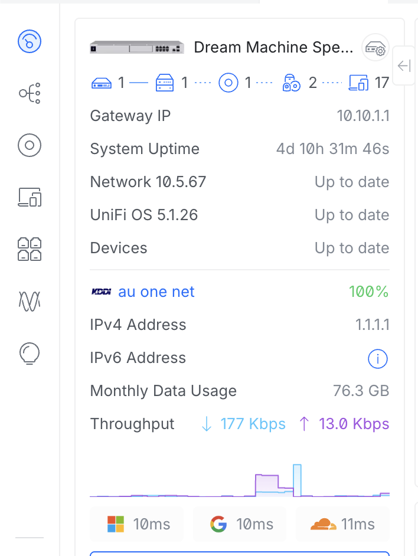

# UniFi JPIX 固定IPスクリプト

[日本語](README.ja.md) | [English](README.md)

> **アーカイブのお知らせ:** UniFi OS 6.0 以降で動作する [UniFi Network 11.0.97](https://community.ui.com/releases/UniFi-Network-Application-11-0-97/15662d06-8122-44e2-a1ba-af5d71b8a045) で、日本の IPv4 over IPv6 サービス向けに IPIP WAN が標準対応となりました。JPIX の v6プラス固定IPサービスには、本スクリプトではなく UniFi の標準設定をご利用ください。以下の手順は旧環境向けの参考資料として残しています。

UniFiゲートウェイによってJPIXの設定がMAP-Eに戻された際に、**v6プラス固定IP**の設定を自動的に再適用します。DHCP予約やLAN内の固定IPアドレスを設定するツールではありません。

## 使い方

JPIX MAP-Eが設定済みのUniFiゲートウェイ、v6プラス固定IPの接続情報、およびroot権限でのSSHアクセスが必要です。`jq`、`flock`、`ubios-udapi-client`は通常UDMにインストールされています。

### 1. リリースをダウンロードする

[最新リリース](../../releases/latest)から次のファイルをダウンロードします。

- `network_watcher.tar.gz`
- `aarch64`の場合は`inotify-go-linux-arm64.tar.gz`、`x86_64`の場合は`inotify-go-linux-amd64.tar.gz`

必要に応じて、ゲートウェイのアーキテクチャを確認します。

```sh
ssh root@unifi uname -m
```

以下のコマンドはARM64を使用する場合の例です。

```sh
tar -xzf network_watcher.tar.gz
tar -xzf inotify-go-linux-arm64.tar.gz
```

`unifi`はゲートウェイのホスト名またはIPアドレスに置き換えてください。

### 2. コピーしてインストールする

```sh
ssh root@unifi 'mkdir -p /data/bin'
scp inotify-go-linux-arm64 root@unifi:/data/bin/inotify-go
scp -r network_watcher root@unifi:/tmp/
ssh root@unifi 'chmod 755 /data/bin/inotify-go'

ssh root@unifi
cd /tmp/network_watcher
./install.sh
```

監視バックエンドには`inotify-go`の使用を推奨します。`inotify-go`がインストールされている場合、インストーラーは`inotify-tools`をインストールしません。

### 3. v6プラス固定IPを設定する

`/data/scripts/ipip/config.env`を編集します。

```sh
vi /data/scripts/ipip/config.env
```

契約時に提供された接続情報を設定してください。`IPV6_REMOTE`はJPIXユーザー共通の値で、テンプレートにあらかじめ設定されています。

```sh
USERNAME="kotei1234567890"
PASSWORD="a1a1a1a1"
IPV4_CIDR="1.1.1.1/32"
IPV6_IID="::0000:0000:0000:0000"
IPV6_REMOTE="2404:9200:225:100::65"
```

変更内容をプレビューします。

```sh
/data/scripts/ipip/configure.sh --dry-run
```

差分を確認して、問題がなければ適用します。

```sh
/data/scripts/ipip/configure.sh
```

設定の適用時に、WAN接続が一時的に切断される場合があります。

復旧後、UniFiダッシュボードの**IPv4 Address**に設定した固定IPアドレスが表示されます。



### 4. サービスを確認する

```sh
systemctl status network-watcher
journalctl -fu network-watcher
```

## 内部の仕組み

UniFi Web UIでネットワーク設定を変更すると、固定IP設定は`map_e_jpix`に戻されます。systemdサービスがUniFiの状態ファイルを監視し、変更が落ち着くまで5秒待ってから、復旧が必要な場合に`configure.sh`を実行します。

`configure.sh`は`map_e_jpix`を`ipip_jpix`に変更し、設定済みの認証情報とトンネル情報を追加して、インターフェースから`192.0.0.x`アドレスを削除します。その後、変更内容を`ubios-udapi-client`で適用します。復旧処理中に発生した複数のイベントは、保留中の1回の確認処理にまとめられます。

UniFi Web UIでネットワーク設定を保存した後、固定IP設定が復旧するまでWAN接続が一時的に切断されることがあります。

通常、`/data`以下のファイルはUniFi OSのアップグレード後も保持されますが、`/etc`以下のsystemdユニットは削除される場合があります。アップグレード後にサービスが見つからない場合は、`install.sh`を再実行してください。既存の`config.env`は保持されます。

> [!WARNING]
> このプロジェクトは、UniFi OSの内部状態ファイルのパスとデータ構造を使用しています。これらはリリース間で変更される可能性があります。メジャーアップグレード後は、`configure.sh --dry-run`で変更内容を確認してください。

## アンインストール

ゲートウェイ上で、展開した`network_watcher`ディレクトリから実行します。

```sh
./uninstall.sh
```

サービスと配置済みのスクリプトが削除されます。`config.env`、`/data/bin/inotify-go`、およびフォールバックとしてインストールされた`inotify-tools`は保持されます。すでにUniFiへ適用されたWAN設定は元に戻りません。
