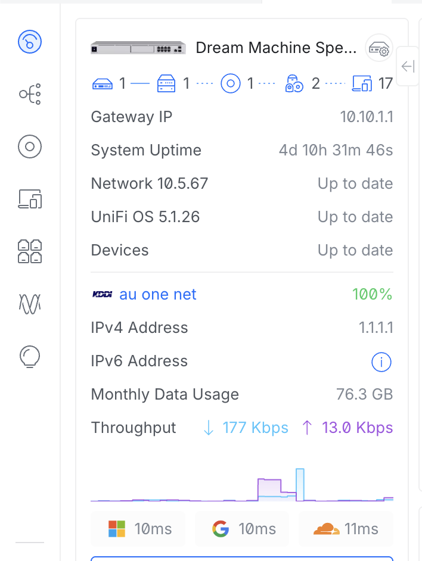

# UniFi JPIX Fixed IP Script

[日本語](README.ja.md) | [English](README.md)

Keeps JPIX **v6 Plus Fixed IP (V6プラス固定IP)** settings active on a UniFi gateway after
UniFi resets them to MAP-E. This is not a DHCP reservation or LAN static-IP
tool.

## How to use

You need a UniFi gateway with JPIX MAP-E already configured, JPIX Fixed IP
credentials, and root SSH access. `jq`, `flock`, and `ubios-udapi-client` are
usually already present on UDM machines.

### 1. Download the release

Download these files from the [latest release](../../releases/latest):

- `network_watcher.tar.gz`
- `inotify-go-linux-arm64.tar.gz` for `aarch64`, or
  `inotify-go-linux-amd64.tar.gz` for `x86_64`

Check the gateway architecture if needed:

```sh
ssh root@unifi uname -m
```

The commands below use ARM64:

```sh
tar -xzf network_watcher.tar.gz
tar -xzf inotify-go-linux-arm64.tar.gz
```

Replace `unifi` with the gateway hostname or IP address.

### 2. Copy and install

```sh
ssh root@unifi 'mkdir -p /data/bin'
scp inotify-go-linux-arm64 root@unifi:/data/bin/inotify-go
scp -r network_watcher root@unifi:/tmp/
ssh root@unifi 'chmod 755 /data/bin/inotify-go'

ssh root@unifi
cd /tmp/network_watcher
./install.sh
```

`inotify-go` is the recommended monitoring backend. When it is installed, the
installer does not install `inotify-tools`.

### 3. Configure JPIX Fixed IP

Edit `/data/scripts/ipip/config.env`:

```sh
vi /data/scripts/ipip/config.env
```

Use the values provided for your connection. `IPV6_REMOTE` is shared by JPIX
users and is already filled in by the template.

```sh
USERNAME="kotei1234567890"
PASSWORD="a1a1a1a1"
IPV4_CIDR="1.1.1.1/32"
IPV6_IID="::0000:0000:0000:0000"
IPV6_REMOTE="2404:9200:225:100::65"
```

Preview the change:

```sh
/data/scripts/ipip/configure.sh --dry-run
```

Review the diff, then apply it:

```sh
/data/scripts/ipip/configure.sh
```

Applying the configuration can briefly interrupt WAN connectivity.

After recovery, the UniFi dashboard should show the configured fixed address
under **IPv4 Address**:



### 4. Check the service

```sh
systemctl status network-watcher
journalctl -fu network-watcher
```

## What happens behind the scenes

Every network configuration change in the UniFi Web UI resets Fixed IP back to
`map_e_jpix`. The systemd service monitors UniFi's state file, waits 5 seconds
for changes to settle, and runs `configure.sh` when recovery is needed.

`configure.sh` changes `map_e_jpix` to `ipip_jpix`, adds the configured
authentication and tunnel values, removes `192.0.0.x` interface addresses, and
submits the result with `ubios-udapi-client`. Events received during recovery
are coalesced into a pending check.

Expect a brief WAN interruption after saving network settings in the UniFi Web
UI while Fixed IP is restored.

Files under `/data` normally survive UniFi OS upgrades, but the systemd unit
under `/etc` may not. If the service disappears after an upgrade, rerun
`install.sh`; the existing `config.env` is preserved.

> [!WARNING]
> This project uses internal UniFi OS state paths and data structures that may
> change between releases. Run `configure.sh --dry-run` after major upgrades.

## Uninstall

From the extracted `network_watcher` directory on the gateway:

```sh
./uninstall.sh
```

This removes the service and deployed scripts. It keeps `config.env`,
`/data/bin/inotify-go`, and any installed `inotify-tools` fallback. It does not
revert the WAN configuration already submitted to UniFi.
